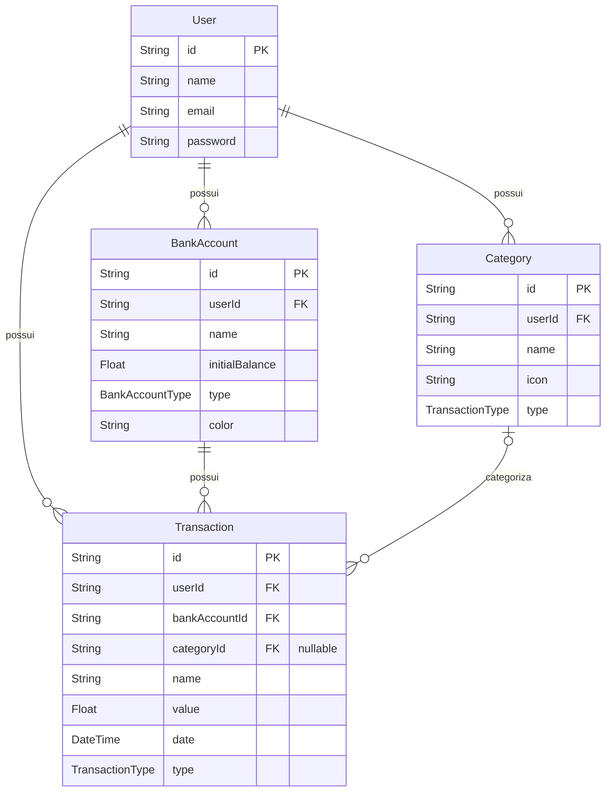

# Arquitetura do Fincheck

Este documento descreve a arquitetura do sistema Fincheck, incluindo a estrutura de diretórios, a modelagem de dados, a infraestrutura e a arquitetura geral do sistema.

## Infraestrutura e Implantação

O Fincheck adota uma arquitetura conteinerizada e desacoplada em nuvem, não utilizando serviços da AWS:

- **Frontend (`web`)**: Single Page Application desenvolvida em React + Vite, hospedada na **Vercel** com roteamento SPA e cabeçalhos de segurança HTTP.
- **Backend (`api`)**: Aplicação NestJS conteinerizada (`node:22-alpine`), implantada no **Render** como Web Service Docker executando sob usuário sem privilégios (`node`).
- **Banco de Dados**: Instância gerenciada do **PostgreSQL 15** no **Render**.
- **Ambiente Local**: Orquestrado via **Docker Compose**, subindo os serviços de banco de dados PostgreSQL, API NestJS e frontend Nginx não privilegiado (`nginxinc/nginx-unprivileged:stable-alpine`).

## Estrutura de Diretórios

O projeto é organizado em dois diretórios principais: `api` e `web`.

### `api` (Backend)

O diretório `api` contém a aplicação NestJS estruturada em módulos de domínio:

```
api
├── prisma/                 # Esquema Prisma e migrações do PostgreSQL
│   ├── schema.prisma       # Definição do esquema do banco de dados
│   └── migrations/         # Histórico de migrações
├── src/                    # Código-fonte da aplicação
│   ├── app.module.ts       # Módulo raiz da aplicação
│   ├── main.ts             # Inicialização do NestJS (prefixo /api/v1, CORS e pipes)
│   ├── modules/            # Módulos de domínio
│   │   ├── auth/           # Autenticação (signup, signin e JWT)
│   │   ├── bank-accounts/  # Gerenciamento de contas bancárias
│   │   ├── categories/     # Gerenciamento de categorias
│   │   ├── transactions/   # Gerenciamento de transações financeiras
│   │   └── users/          # Perfil do usuário (/users/profile)
│   └── shared/             # Recursos compartilhados
│       ├── config/         # Validação de variáveis de ambiente
│       ├── database/       # Conexão e repositórios do Prisma
│       ├── decorators/     # Decorators customizados (@IsPublic, @ActiveUserId)
│       └── pipes/          # Pipes customizados de validação
└── ...
```

### `web` (Frontend)

O diretório `web` contém a aplicação React desenvolvida com Vite e Tailwind CSS v4:

```
web
├── public/                 # Arquivos estáticos públicos
├── src/                    # Código-fonte da aplicação
│   ├── app/                # Camada de lógica e serviços
│   │   ├── contexts/       # Contextos React (ex.: AuthContext)
│   │   ├── entities/       # Definições de tipos e interfaces TypeScript
│   │   ├── hooks/          # Hooks customizados
│   │   ├── services/       # Clientes HTTP (Axios) para consumo da API
│   │   └── utils/          # Funções utilitárias (formatação de moeda, datas)
│   ├── assets/             # Imagens, ilustrações e ícones
│   ├── view/               # Camada de apresentação e interface
│   │   ├── components/     # Componentes reutilizáveis (botões, inputs, modais)
│   │   ├── layouts/        # Layouts estruturais (AuthLayout)
│   │   └── pages/          # Páginas da aplicação (Dashboard, Login, Register)
│   └── ...
└── ...
```

## Modelagem de Dados (ERD)

O diagrama abaixo representa as entidades persistidas no PostgreSQL via Prisma ORM:


